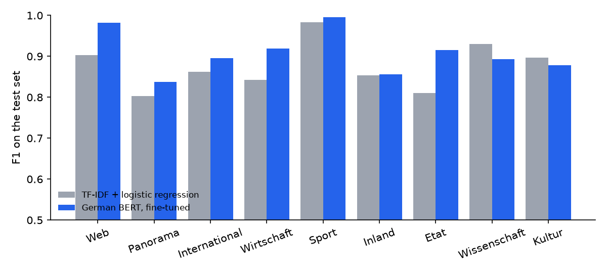
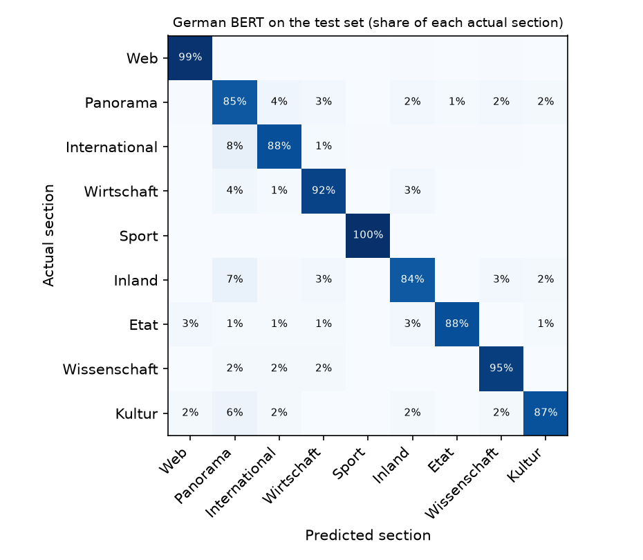

# German News Classifier


Sorting German newspaper articles into their sections: a TF-IDF baseline compared with a fine-tuned German BERT model, on accuracy, speed, size and the kinds of errors each makes. The same setup applies to routing support tickets, e-mails or documents to the right team.

## Data

[GNAD10](https://huggingface.co/datasets/community-datasets/gnad10) has 10,273 articles from the Austrian newspaper *Der Standard* in 9 sections:

| Section | Training articles |
|---|---:|
| Web | 1,509 |
| Panorama (mixed news) | 1,510 |
| International | 1,360 |
| Wirtschaft (business) | 1,270 |
| Sport | 1,081 |
| Inland (Austrian politics) | 913 |
| Etat (media) | 601 |
| Wissenschaft (science) | 516 |
| Kultur (culture) | 485 |

The splits:
- **Training:** 9,245 articles, of which 10 % are held out as a validation split for model choices.
- **Test:** the official test set of 1,028 articles, used once at the end.

Articles average about 2,600 characters, longer than the 512 tokens BERT can read, so the model sees the headline and roughly the first half of each article.

## Results

Test set, 1,028 articles:

| Model | Accuracy | Macro F1 | Speed per article | Model size |
|---|---:|---:|---:|---:|
| Always "Panorama" | 16.3 % | 0.03 | – | – |
| TF-IDF + logistic regression | 87.2 % | 0.876 | **0.3 ms** (CPU) | **23 MB** |
| **German BERT, fine-tuned** | **91.1 %** | **0.908** | 5.6 ms (GPU), 218 ms (CPU) | 440 MB |



**BERT is 4 points more accurate, but about 640 times slower on a CPU and 19 times larger.** Which to use depends on volume and hardware:
- for a few thousand documents a day, BERT on a CPU is fine;
- for millions, or on a small server, the baseline does the job at 87 %.

**BERT doesn't win everywhere.** It gains most on Web (+8 points F1), Wirtschaft (+8) and Etat (+11). On the two smallest sections, Wissenschaft and Kultur, which have about 500 training articles each, the TF-IDF model is slightly better (0.93 vs 0.89 and 0.90 vs 0.88).

## Error analysis



- **"Panorama", the mixed-news section, causes most errors.** The most common confusions are International ↔ Panorama and Inland → Panorama. Many of these articles could belong to either section. One example, labelled International: *"Deutschlands Justizminister Heiko Maas: 'Wir dürfen nicht abwarten, bis es die ersten Toten gibt'"*. For an Austrian paper, that's foreign news; by its content it could just as well be Panorama.
- **The two models get many of the same articles wrong.** 60 of BERT's 91 errors are also errors of the TF-IDF model. They are hard or ambiguous cases rather than random mistakes.
- **Confidence can be used to route articles.** If only predictions with at least 95 % confidence are filed automatically and the rest go to an editor:

| Confidence threshold | Filed automatically | Accuracy of those |
|---|---:|---:|
| none | 100 % | 91.1 % |
| 0.70 | 96.7 % | 92.8 % |
| 0.90 | 92.8 % | 94.4 % |
| 0.95 | 89.1 % | 95.7 % |

The model is overconfident: even above 95 % confidence, 4.3 % of predictions are wrong. A threshold has to be chosen from a table like this, not from the confidence value alone.

## Method

**Baseline:**
- TF-IDF on words and word pairs, with logistic regression.
- The regularisation strength was chosen on the validation split from 4, 16, 64 and 256. 64 was best, and the larger value was tried to check it wasn't the edge of the grid.

**Fine-tuning** of [`deepset/gbert-base`](https://huggingface.co/deepset/gbert-base) with the Hugging Face Trainer:
- **Settings:** 3 epochs, learning rate 3e-5 with warm-up, batch size 16, mixed precision.
- **Hardware and time:** 9.4 minutes on an 8 GB laptop GPU (RTX 4060).
- **Model choice:** the epoch with the best validation macro F1 was kept. Validation F1 was 0.905, 0.921 and 0.933 after epochs 1–3, so more epochs might still help.

**Measured:**
- accuracy and macro F1, which weights the small sections equally;
- per-section F1, confusion matrix, confidence thresholds;
- inference time per article and model size.

## Running it

```bash
python -m venv .venv
.venv\Scripts\activate             # source .venv/bin/activate on Mac/Linux
pip install torch --index-url https://download.pytorch.org/whl/cu124   # or the CPU build
pip install -r requirements.txt

python baseline.py                 # about 2 minutes
python finetune.py                 # about 10 minutes on a GPU; downloads gbert-base (440 MB)
python report.py                   # comparison, charts, error analysis
pytest                             # 4 tests: data splits, metrics, timing, baseline
```

## Project structure

```
common.py      data download, train / validation / test splits, metrics, timing
baseline.py    majority class and TF-IDF + logistic regression
finetune.py    fine-tuning German BERT, test evaluation, speed measurement
report.py      comparison, per-section F1, confusion matrix, confidence analysis
results/       metrics per model (JSON), test predictions, comparison.json
docs/          charts
```

## Limitations

- **One newspaper, one period** (2015–2016). Sections and topics drift, so a production model would need periodic re-evaluation.
- **Truncated articles.** Only the first 512 tokens are used. Classifying several chunks and combining them might help on long articles.
- **One fine-tuning run.** The settings weren't tuned, and results from a single seed carry some noise; a second seed would show how stable the 91.1 % is.
